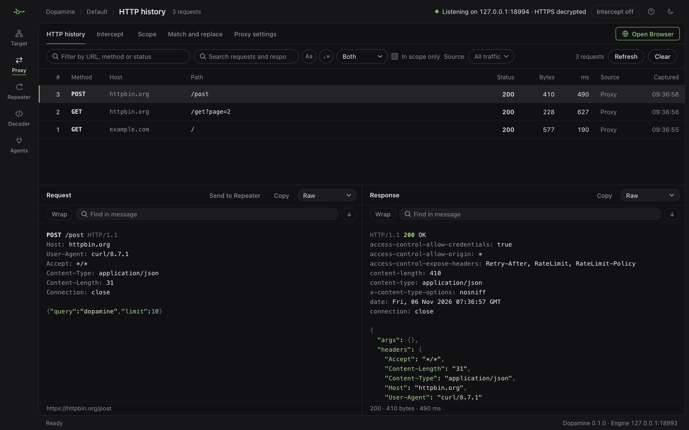
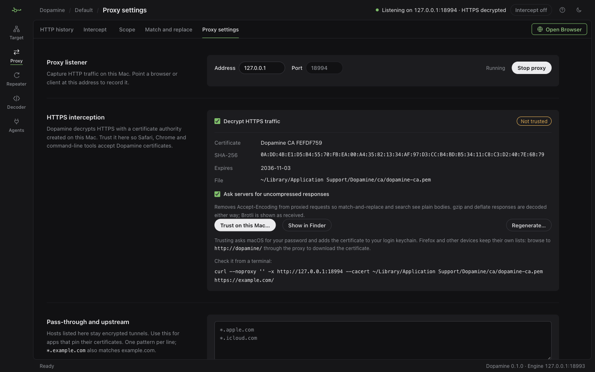

# Dopamine

Dopamine is an HTTP and HTTPS testing proxy for macOS. Capture traffic from a browser or client, decrypt HTTPS with a local certificate authority, hold and edit requests and responses, rewrite them with rules, replay them in Repeater, and let local AI agents work with the same traffic over MCP. Each engagement is one project file.

[](https://github.com/Alexander1022/Dopamine/actions/workflows/ci.yml)

**Version 0.1.0** · macOS 13 or later · Apple Silicon and Intel · [MIT License](LICENSE)



> Use Dopamine only on systems you own or are authorized to test.

## Features

- **Projects**: one `.dopamine` file per engagement holds HTTP history, Repeater tabs, scope and rules, saved as you go. New, Open, Open Recent and Rename or Move from the File menu.
- **Proxy** on `127.0.0.1:18080` (configurable) with HTTP history, filtering by URL, method, status and source, and **search** inside headers and bodies (substring or regex).
- **Open Browser** launches Chrome, Brave, Edge or Chromium with a throwaway profile that already uses the proxy, with the browser's background traffic turned off.
- **Scope**: include and exclude host patterns. Intercept only holds in-scope requests, and HTTP history shows in-scope traffic by default.
- **Match and replace** rules rewrite request and response lines, headers and bodies before Intercept. History keeps both the original and what was sent.
- **Compressed responses** (gzip, deflate) are decoded, and proxied requests ask for uncompressed responses by default.
- **HTTPS interception.** A per-install certificate authority issues host certificates on demand. Decrypted HTTPS appears in history, Intercept, Site map and Repeater like HTTP. Certificate-pinned hosts can be kept as encrypted pass-through tunnels.
- **Intercept** requests and, per request, their responses: edit, change destination, forward, drop, or forward/drop all.
- **Repeater** tabs with per-tab send history, notes, and cURL import (`Copy as cURL` from any browser).
- **Site map** of observed hosts and paths.
- **Message views**: Raw, Pretty (JSON), Hex, Headers, Body, Query params, Cookies, with highlighting and search.
- **Decoder**: Base64, URL, HTML entities, hex, SHA-256.
- **Agents**: a built-in MCP server (27 tools) for Codex, Claude and other MCP clients, with four access tiers: Read (default), Workspace, Active and Everything. Below Everything, rules agents draft start off and agents must confirm before sending to hosts outside the scope. **Agent history** keeps every call in the project: what the agent did, which endpoints it touched, with links to the exchanges. See [docs/MCP.md](docs/MCP.md).
- **Annotations**: highlight history rows and add notes, by right-click or by agents.
- **Native macOS app**: menu bar item with held-message count, Dock badge, keyboard shortcuts, light and dark appearance, and an animated startup splash with a short cinematic hit (turn it off with **Dopamine → Startup Sound**).

## Install

**Requirements:** macOS 13 or later, Apple Silicon or Intel, and the Xcode Command Line Tools. Dopamine runs its engine with the system Python (`/usr/bin/python3`, 3.9 or later) and creates certificates with `/usr/bin/openssl`; nothing else is installed. If Python is missing, run:

```sh
xcode-select --install
```

### Install script

```sh
curl -fsSL https://github.com/Alexander1022/Dopamine/releases/latest/download/install.sh | sh
```

The script checks macOS and Python, downloads the release zip, verifies it against the release's `SHA256SUMS.txt`, and copies Dopamine to `/Applications` (or `~/Applications` if `/Applications` isn't writable). It never asks for a password, and because `curl` downloads aren't quarantined, Dopamine opens without the Gatekeeper step. Running it again upgrades Dopamine and keeps your projects and settings.

To read it before running it:

```sh
curl -fsSLO https://github.com/Alexander1022/Dopamine/releases/latest/download/install.sh
less install.sh
sh install.sh
```

The checksum file comes from the same release as the zip, so it catches a damaged download, not a tampered release.

### From a release

1. Download `Dopamine-0.1.0.dmg` (or `Dopamine-0.1.0-macOS.zip`) and `SHA256SUMS.txt` from [Releases](https://github.com/Alexander1022/Dopamine/releases).
2. Check the download, in the folder where you saved it:

   ```sh
   shasum -a 256 -c SHA256SUMS.txt --ignore-missing
   ```

3. Open the DMG and drag **Dopamine** to **Applications**.
4. The build is ad-hoc signed, not notarized, so macOS blocks the first launch. Open Dopamine once, then go to **System Settings → Privacy & Security** and click **Open Anyway**. (On macOS 13 and 14 you can instead Control-click Dopamine → **Open** → **Open**.)

### From source

Building needs the same Command Line Tools (`swiftc`); no Xcode project, package manager or network access is used.

```sh
git clone https://github.com/Alexander1022/Dopamine.git
cd Dopamine
./build.sh
```

This builds a universal `Dopamine.app` in the repository folder. Run it in place with `open Dopamine.app`, or install it:

```sh
ditto Dopamine.app /Applications/Dopamine.app
```

A build you make yourself is not quarantined, so it opens without the Gatekeeper step.

### Uninstall

Remove trust for the Dopamine certificate first (**Proxy settings → Remove trust**, or delete the "Dopamine CA …" certificate in Keychain Access). Then quit Dopamine and run `sh install.sh --uninstall`, or delete `/Applications/Dopamine.app` and `~/Library/Application Support/Dopamine` yourself. Your projects in `~/Documents/Dopamine Projects` are left alone.

## Quick start

1. **Proxy → Proxy settings → Start proxy.**
2. Under **HTTPS interception**, click **Trust on this Mac…** and approve the macOS prompt. This adds the Dopamine certificate to your login keychain, so Safari, Chrome and command-line tools accept it.
3. Click **Open Browser** at the right of the Proxy tabs (⇧⌘B). Or point any client's HTTP and HTTPS proxy at `127.0.0.1:18080`, for example from a terminal:

   ```sh
   curl --noproxy '' -x http://127.0.0.1:18080 https://example.com/
   ```

4. Traffic appears in **HTTP history**. Right-click a request to add its host to **Scope**, select it to inspect it, or send it to **Repeater**.
5. Turn **Intercept** on (⌘I) to hold in-scope requests, edit them, and forward or drop them.
6. Start a project per engagement with **File → New Project** (⌘N), then **Rename or Move…** to name it.

## Projects

A project is one `.dopamine` file (SQLite inside) holding HTTP history, Repeater tabs, scope and match-and-replace rules. Everything is written as it happens; there is no Save. New projects go to `~/Documents/Dopamine Projects` with a dated name. One project is open at a time: opening another keeps the proxy running and sends new traffic to it, and if Intercept is holding messages Dopamine asks whether to forward or drop them first. The last project reopens at launch. Double-click a `.dopamine` file in Finder to open it.

Proxy settings, the certificate authority, pass-through hosts and appearance are global to the Mac, not part of a project.

The first time Dopamine opens a project in Documents, macOS asks whether Dopamine may access that folder. Because the app is ad-hoc signed, macOS may ask again after an update.

Firefox and other devices keep their own certificate lists: browse to **http://dopamine/** through the proxy to download the certificate, then import it as an authority. If a client rejects the certificate, Dopamine shows a notice and records the failed handshake in history.

### HTTPS settings

The HTTPS interception settings are under **Proxy → Proxy settings**.



| Setting | Default | Effect |
| --- | --- | --- |
| Decrypt HTTPS traffic | On | Off passes all HTTPS through as encrypted CONNECT tunnels. |
| Pass-through hosts | None | Host patterns (`*.apple.com` also matches `apple.com`) that are never decrypted. |
| Verify server certificates | On | Off allows test servers with self-signed or internal certificates. Applies to the proxy, Repeater and agents. |
| Regenerate | — | Replaces the certificate authority. Remove trust for the old one first. |

The CA private key stays in the data folder (mode 0600) and is unique to your install. Remove trust from **Proxy settings** or Keychain Access when you stop using Dopamine.

## Keyboard shortcuts

| Shortcut | Action |
| --- | --- |
| ⌘1 – ⌘6 | Site map, HTTP history, Intercept, Repeater, Decoder, Agents |
| ⌘N / ⌘O | New project / open project |
| ⇧⌘B | Open Browser |
| ⇧⌘P | Start or stop the listener |
| ⌘I | Intercept on or off |
| Ctrl+F / Ctrl+D | Forward / drop the selected held message |
| ⌘T | New Repeater tab |
| ⌘↩ | Send in Repeater |
| ⇧⌘I | Import cURL |
| ⌘F | Find |
| ⌘, | Proxy settings |
| ⇧⌘L | Switch appearance |
| ⌘0 | Show the main window |

Closing the window keeps Dopamine running in the menu bar with the listener active. Quit with ⌘Q.

## Data and privacy

- Everything stays on this Mac. The UI, engine and MCP endpoint listen on `127.0.0.1` only; the engine is at `http://127.0.0.1:18765`. Its API requires a token created at each launch, and MCP requires the bearer token in `mcp-token`.
- Projects: `.dopamine` files, by default in `~/Documents/Dopamine Projects`. They contain captured requests and responses, including headers, cookies and bodies, so treat them as sensitive.
- Data folder: `~/Library/Application Support/Dopamine` — `settings.json` (including the recent projects list), `ca/` (certificate authority), `mcp-token`, `mcp-settings.json`, `server.log`. History from development builds (`history.sqlite3`) and their Repeater tabs move into `Default.dopamine` on first launch; the old file is kept as `history.sqlite3.migrated`.
- Dopamine never changes system proxy settings. Certificate trust changes only when you click **Trust on this Mac…** and approve the macOS prompt.

## Limits in 0.1

- HTTP/1.1 only. HTTPS clients are offered HTTP/1.1 via ALPN; HTTP/2 and WebSocket traffic is not relayed.
- Bodies are limited to 8 MiB; requests time out after 30 seconds; held messages expire after five minutes. Search indexes the first 1 MiB of each text body.
- Brotli (`br`) response bodies are shown as received; gzip and deflate are decoded.
- The engine normalizes framing headers and recalculates Content-Length; it is not a byte-exact request-smuggling tool.
- No scanner, fuzzer (Intruder) or comparer yet.

## Development

```sh
./build.sh          # build Dopamine.app (universal)
./release.sh        # run all tests, build, and create dist/ (DMG, zip, install.sh, checksums)
/usr/bin/python3 -m unittest discover -s tests   # engine, HTTPS and MCP tests only
```

Node is optional; `release.sh` uses it for the cURL and Intercept UI checks when it is installed.

Run the engine without the native shell: `/usr/bin/python3 engine/server.py`, then open the `http://127.0.0.1:18765/?token=…` address it prints. The API requires that per-launch token.

| Path | Purpose |
| --- | --- |
| `macos/` | Native window, engine lifecycle, menus, projects, Open Browser, menu bar and Dock (Swift) |
| `engine/server.py` | Proxy, HTTPS interception, Intercept, Repeater and local API |
| `engine/project.py` | Project files: history, search index, scope, rules, Repeater tabs, migration |
| `engine/rewrite.py` | Response decompression and match-and-replace |
| `engine/tls_ca.py` | Certificate authority and per-host certificates |
| `engine/dopamine_mcp.py` | MCP tools and stdio bridge |
| `ui/` | User interface (HTML, JavaScript, CSS) and startup splash |
| `tests/` | Engine, HTTPS, project, MCP, cURL and Intercept tests, and the MCP evaluation |
| `assets/` | App icon and startup sound (`make-startup-sound.py` regenerates `startup.m4a`) |
| `docs/` | MCP guide and screenshots |
| `build.sh`, `release.sh` | Build the app; test, build and package a release |
| `install.sh` | Release installer (the version is filled in by `release.sh`) |
| `VERSION` | Release version used by the build |

See [CHANGELOG.md](CHANGELOG.md) for release notes and [docs/MCP.md](docs/MCP.md) to connect AI agents.

## Security and license

Report vulnerabilities as described in [SECURITY.md](SECURITY.md). Dopamine is released under the [MIT License](LICENSE). It is an independent project and is not affiliated with PortSwigger or Burp Suite.
